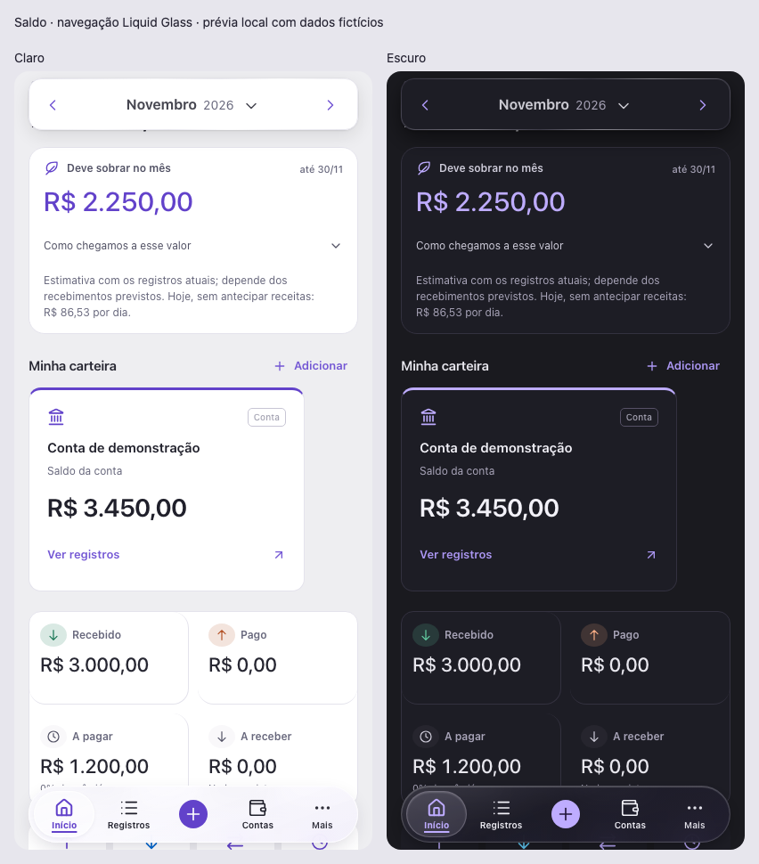

# Floating Liquid Glass Navigation

Local implementation, November 5, 2026. No commit, push, deployment or user financial data changes.

## Audit

The existing application is a vanilla ES-module hash SPA with persistent HTML shell, React 19.2.6 reading islands, Vinext 1.0.0-beta.5/Vite 8.0.13 server, Tailwind 4.2.1, shadcn/ui, Lucide React 1.31 and Motion 14.9.1. Navigation previously used a static five-position dock; overlapping legacy CSS forced an opaque full-width material. Desktop uses a sidebar at 960px and above. Initial Git working tree was clean at `bc91127`.

Real client routes: `#overview`, `#transactions`, `#accounts`, `#planning`, `#recurring`, `#settings`. The legacy `#accounts-section` alias remains supported. Server endpoints `/api/session` and `/api/ledger` are unchanged. The central creation control remains an action; More retains the existing planning, recurring, settings and profile flows.

## Real upstream reuse

| Repository | Pinned revision | Source inspected / incorporated | License |
|---|---|---|---|
| [Opaline](https://github.com/deepraj21/opaline/tree/b40cc2adc96e7d92abfd2b14c25fc0f3945d29f1) | `b40cc2a` (package 0.1.0) | Adapted `registry/opaline/ui/opaline/glass-tab-bar.tsx` structure and item markup. Incorporated `registry/opaline/hooks/use-active-indicator.ts` with only attribution header added. Inspected `liquid-glass.tsx`; replaced its optical engine with CSS material appropriate for Safari. | MIT, Deepraj Bera; `licenses/opaline.txt` |
| [Liquid Glass Nav](https://github.com/dev-okazawa/liquid-glass-nav/tree/a36b0a113f481471928a107bb62aed751d4c920f) | `a36b0a1` (1.1.1) | Inspected `react/LiquidGlassBottomNav.tsx` and `style.css`. Adapted effect/tint/shine surface layers, contact feedback and Safari filter separation. Kept app actions instead of FAB demo links. | MIT, Okazawa; `licenses/liquid-glass-nav.txt` |
| [Glass HQ](https://github.com/Glass-HQ/liquid-glass/tree/089c396ccb6f46233973a8c7758fad90e1713c97) | `089c396` (0.0.2) | Evaluated `surface.tsx`, `toolbar.tsx`, `tabs.tsx` including GlassTabsIndicator, `scene.tsx`, package and license. Not incorporated: requires scene engine, vgpu, @lisse/core and another base-ui version for one small persistent control. | MIT; evaluated only |

No dependencies installed. Opaline source uses ordinary React hooks supported by the current version, despite its repository using newer development versions. The installed Motion provides the spring and reduced-motion behavior. Notices are preserved in source and copied into distributed `public/licenses/` assets.

## Integration

- One persistent navigation React root, separate from financial reading roots; page/data renders retain focus and spring state.
- Route-controlled selection, native hash anchors, existing hashchange handler and unchanged modal action delegation. No new router, optimistic tab state or fake destinations.
- 64px capsule, 420px maximum width, at least 16px lateral margins and 8px plus `env(safe-area-inset-bottom)` bottom gap. Asymmetric horizontal safe areas also respected.
- Actual backdrop blur (16px), saturation and separate low-opacity tint/shine layers; lens uses measured active item and Motion spring transforms. No displacement SVG, WebGL, WebGPU or permanent rendering loop added.
- Existing light/dark brand tokens, visible labels, current-page underline and lens, named nav, hidden decorative icons, visible focus and targets at least 44px.
- Reduced motion disables translations/press deformation; reduced transparency and unsupported blur have an opaque fallback. Forced colors retains a visible selection border.
- VisualViewport plus editable focus detects keyboard occlusion and hides/inerts navigation. Hardware keyboard focus or zoom alone does not hide it.
- Shared content/notification clearance keeps the last content above the capsule. Desktop sidebar, auth gate, privacy, financial calculations and APIs remain intact.
- Service worker precaches `navigation.js`; normal asset fingerprinting includes the bundled navigation JS/CSS.

## Files

Created:
- `components/navigation/floating-liquid-glass-nav.tsx`
- `components/navigation/floating-liquid-glass-nav.css`
- `components/navigation/vendor/use-active-indicator.ts`
- `navigation.js`, `navigation.test.js`
- `tests/navigation.browser.mjs`
- `licenses/opaline.txt`, `licenses/liquid-glass-nav.txt`
- This document, `docs/navigation/mobile-light.png`, `mobile-dark.png`, `mobile-board.png`, `report.json`
- `.planning/2026-11-05-floating-liquid-glass-navigation/` audit/progress/plan and active-plan marker

Modified:
- `app.js`: mount persistent navigation and share route resolver.
- `components/finance/entry.tsx`: export independent navigation root lifecycle.
- `index.html`: single nav host, remove redundant static items.
- `premium.css`: retire conflicting opaque dock declarations; shared bottom clearance.
- `scripts/prepare-client.mjs`: copy navigation module and license notices.
- `sw.js`: offline precache new module.
- `package.json`: syntax/unit/browser test commands; no dependency changes.
- `pwa.test.js`: offline navigation-module coverage.

## Verification

- `npm run check`: passed.
- `npm test`: **102 passed**, zero failed.
- `npm run lint`: passed without warnings.
- `npm run build`: passed (client + server + endpoints). Existing framework deprecation notices for inlineDynamicImports/module.register remain.
- Navigation-only strict TypeScript: passed:
  `node node_modules/typescript/bin/tsc --noEmit --strict --allowJs --skipLibCheck --module esnext --moduleResolution bundler --jsx react-jsx --target es2022 components/navigation/floating-liquid-glass-nav.tsx`
- Full `tsc --noEmit --incremental false`: **not passing**. Nine diagnostics predate this task: raw HTML import typing in `app/route.ts`, inferred JS types/DOM append in financial entry, React child props in existing animated-background vendor component. Before/after diagnostics are identical after normalizing shifted line numbers. No new navigation diagnostic.
- `git diff --check`: passed.
- Impeccable detector: only existing unrelated `premium.css` wallet top-border warning; no new navigation finding.

`npm run test:navigation:browser` uses actual built SPA source on an isolated loopback server, fictional ledger, mocked local API and a separate Chrome profile. It clears only the test origin's storage to avoid older service-worker assets. It checks all six pages in both themes at 320/393/402/430px, landscape and desktop, last content, real links, history, refresh, legacy deep link, More/creation dialogs, indicator movement/alignment, reduced motion, reduced-transparency fallback, accessibility names, keyboard focus and PWA cached navigation offline. Zero ledger writes and zero JS exceptions. See `docs/navigation/report.json`.

To reproduce, build first, launch an isolated Chrome with `--headless=new --disable-gpu --remote-debugging-port=9230 --user-data-dir=/private/tmp/saldo-navigation-test-profile`, then run the browser test command. Port 8766 must be available. The harness only serves local test data and closes its server afterward.

## Evidence and limitations

Screenshots below are real Chromium renders of the implementation with explicitly fictional data; they are not generated mockups. The composite only places the original light/dark captures side by side.

Actual Safari/iOS and Chrome/Android hardware, installed standalone PWA launch, physical keyboard viewport changes and device-reported safe-area values were not available for testing. Chromium emulation is not proof of physical iPhone behavior. CSS uses Safari-prefixed backdrop-filter without simultaneous SVG filters, but final hardware verification remains recommended. Optical refraction is deliberately omitted in favor of the browser-compatible layered material.
